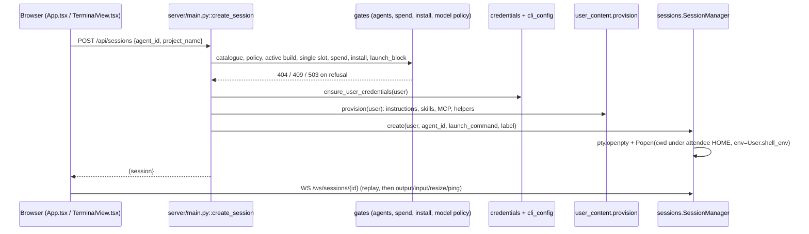
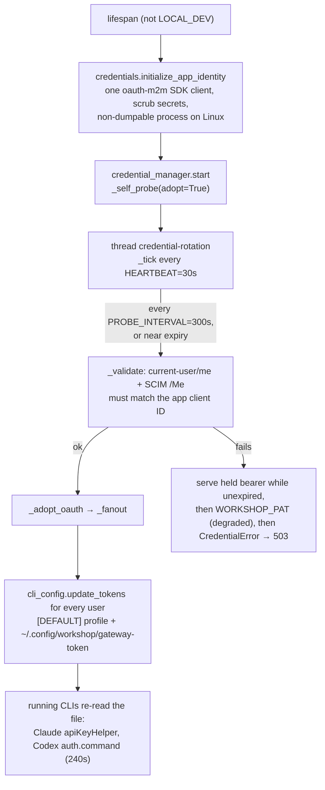
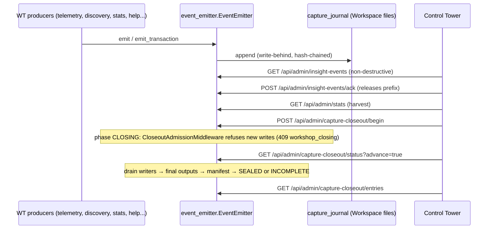

# Flows: how the system actually works

The end-to-end paths that matter most, traced through code at `c1bae5d`. Each step names a
`path::symbol` that the guide test checks still exists. Unmarked statements were read in
code; *(inferred)* marks a conclusion drawn from structure rather than read, and *(gap)*
marks missing coverage. A flow only states what its trace established; behaviour you are
about to change should be re-read in code.

Contents:

1. [Request identity and seat binding](#1-request-identity-and-seat-binding)
2. [Launching an agent terminal](#2-launching-an-agent-terminal)
3. [Credential lifecycle](#3-credential-lifecycle)
4. [Process start, toolchain bootstrap and readiness](#4-process-start-toolchain-bootstrap-and-readiness)
5. [Attendee build journey](#5-attendee-build-journey)
6. [Operator steering and content](#6-operator-steering-and-content)
7. [Control Tower delivery and sealed closeout](#7-control-tower-delivery-and-sealed-closeout)
8. [Omnigent paired host](#8-omnigent-paired-host)

## 1. Request identity and seat binding

**Trigger:** most attendee routes take `Depends(server/auth.py::get_current_user)`,
WebSockets call `server/auth.py::get_ws_user`, and `server/admin.py::router` applies
`server/auth.py::require_admin` to every operator route.

**Sequence**

1. `server/auth.py::_principal_from_headers` reads the Apps proxy headers
   (`X-Forwarded-Email` or `X-Forwarded-User`, and `X-Forwarded-Access-Token`). With no
   identity it returns 403.
2. `server/auth.py::_check_access` resolves the seat owner, `server/attendee.py::resolved_email`,
   in this order: `WORKSHOP_ATTENDEE_EMAIL`, then the persisted `DATA_ROOT/shared/attendee.json`,
   then unbound.
   - An unbound instance is claimed by the first non-admin caller (`server/attendee.py::bind`,
     write-once). An operator cannot claim it.
   - A different identity gets 403 with `X-Workshop-Error-Code: wrong_seat_identity`.
   - If `ACCESS_GROUP` is set, membership is required.
3. `server/auth.py::_capture_obo` hands the forwarded user token to `server/obo.py::OboManager`.
   It never raises.
4. WebSockets accept first, then close with `4403` so the browser sees the code
   (`server/ws.py`).
5. `server/auth.py::require_admin` treats a bearer with no proxy headers as a service principal.
   It allows `ADMIN_GROUP` (default `platform_admins`) and `config.admin_groups()`.
   `server/auth.py::get_groups` uses SCIM `/Me` with the caller's token, falls back to an email
   lookup with the app credential, and caches for 5 minutes. A lookup failure is an empty set,
   which means deny.

**Config:**

- `LOCAL_DEV=1` uses `DEV_FAKE_EMAIL` and `DEV_GROUPS` and skips binding.
- `WORKSHOP_ATTENDEE_EMAIL`, `ACCESS_GROUP` and `ADMIN_GROUP` are read in `server/config.py`.
- `ALLOW_SHARED_TOPOLOGY` acknowledges the unsupported shared-instance caveat
  (`server/topology.py`).

**Tests:** `tests/test_auth.py`, `tests/test_attendee.py`, `tests/test_topology.py`,
`tests/test_credentials_security.py` (SCIM). Frontend: `frontend/src/api.ts` latches the
wrong-seat 403.

*(gap)* There is no test of behaviour during a SCIM outage for `ACCESS_GROUP` callers. They
are denied, not given a 503.

## 2. Launching an agent terminal

**Trigger:** the agent cards (`frontend/src/components/AgentCards.tsx`) call
`frontend/src/api.ts`, which sends `POST /api/sessions` to `server/main.py::create_session`.

**Sequence**

1. `server/agents.py::get_agent` → `server/agents.py::load_catalog` reads `content/agents.json`
   and keeps only `server/agents.py::SUPPORTED_AGENT_IDS` (omnigent, claude, codex). Then
   `WORKSHOP_AGENTS` and the Omnigent flag filter it. An unknown agent is a 404.
2. Gates, in order:
   - model policy synced, when `WORKSHOP_MODEL_POLICY_REQUIRED` is set (503 "still syncing");
   - the active build matches the request (409);
   - the single session slot is free (`server/sessions.py::SessionManager.active`, 409 `session_conflict`);
   - the emergency kill switch (`server/spend.py::check_can_launch`);
   - the toolchain is installed (`server/bootstrap/install.py::ready` and `failure_for`:
     503 with a retry on failure, 409 while still installing);
   - the Omnigent credential is fresh (`server/agents.py::launch_block`; on block
     `server/selfheal.py::SelfHealer` recovers, then 503 `obo_stale`).
3. `server/credentials.py::ensure_user_credentials` writes or refreshes the CLI config through
   `server/cli_config.py::configure_all` or `update_tokens`. Failure gives 503
   `credential_unavailable`.
4. `server/user_content.py::provision` writes instructions, skills links, MCP config and
   helpers ([attendee environment](areas/attendee-agent-environment.md)). A required-step
   failure is 503 via `PreparationError`.
5. Under the user's content lock and `server/spend.py::launch_guard`:
   - `server/agents.py::claim_opener` picks the first message;
   - Claude gets plan or auto flags depending on `server/build_plan.py::approved_for_active`;
   - `server/agents.py::launch_command` builds the argv.
6. `server/sessions.py::SessionManager._create` holds the manager lock and enforces one
   session.
   - cwd is `server/projects.py::launch_directory`, the active project or `~/projects`.
   - Codex gets a short HOME alias from `server/codex_home.py::shell_home`.
   - It spawns under a new PTY with `server/users.py::User.shell_env`. That env is
     deny-by-default: `WORKSHOP_PAT` and client secrets never reach the PTY.
7. A reader thread feeds `server/sessions.py::SessionManager.publish_output`:
   - output goes into a 2 MiB `ByteScrollback`;
   - subscribers get it through the event loop;
   - `server/main.py::_observe_output` records topic names only, never content, which drives
     the "spotted in your session" nuggets.
8. `server/identity.py::observe` records which principal each CLI resolves to, in the
   background.

**Terminal socket:** `server/ws.py::session_socket` authenticates after accept (4403) and
looks up the session owner-scoped (4404). It calls
`server/sessions.py::SessionManager.attach_with_replay`, which snapshots the scrollback and
subscribes atomically, sends `replay`, then streams. Other closes:

- `4408` for a slow consumer (`server/ws.py::pump_terminal_output`);
- `4410` when the workshop is closing;
- `4413` when capture is held.

`frontend/src/components/TerminalView.tsx` reconnects with backoff, up to 12 attempts.

**Lifecycle:**

- `server/sessions.py::SessionManager.terminate` sends SIGHUP and then SIGKILL to the process
  group.
- A reaper runs every 60 s. It ends sessions idle for longer than
  `SESSION_IDLE_TIMEOUT_SECONDS` (default 8 h).
- With `SESSION_STATE_PATH` set, `server/session_store.py` journals metadata only.
  `server/sessions.py::SessionManager.load_prior` turns pre-restart sessions into
  `server_restarted` ghosts, so scrollback is never persisted.

**Tests:**

- Server: `tests/test_sessions.py`, `tests/test_agent_selection.py`,
  `tests/test_stream_limits.py` (cap, 4408), `tests/test_session_store.py`,
  `tests/test_obo_gating.py`, `tests/test_user_content.py`, `tests/test_shell_env.py`,
  `tests/test_ws_capture_operations.py`.
- Frontend: `frontend/src/terminalExit.test.ts`, `frontend/src/sessionSwitch.test.ts`.

*(gap)* No test covers the reconnect loop in `frontend/src/components/TerminalView.tsx`, or
its handling of 4408. It falls through to a generic reconnect.

## 3. Credential lifecycle

Two planes, explained in [docs/auth-identity-model.md](../auth-identity-model.md) and
[ADR 0002](../adr/0002-attendee-credential.md).

- **Builds** use the app service principal's OAuth bearer, profile `[DEFAULT]`.
- **Attendee-governed reads** use the attendee's OBO token, profile `[me]`, only when
  `ENABLE_OBO=true`.

**Sequence (app plane)**

1. `server/main.py::lifespan` calls `server/credentials.py::initialize_app_identity` before
   any installer or PTY starts. In production, startup fails if the process cannot be made
   non-dumpable.
2. `server/credentials.py::CredentialManager.start` probes synchronously, then runs
   `server/credentials.py::CredentialManager._tick`.
3. `server/credentials.py::CredentialManager._refresh_if_near_expiry` forces a mint inside
   `EXPIRY_FORCE_WINDOW` (300 s), with a 60 s cooldown.
4. `server/credentials.py::CredentialManager._validate` binds the bearer to the injected app
   identity. `userName` alone is never proof.
5. `server/credentials.py::CredentialManager._fanout` calls
   `server/cli_config.py::update_tokens` for every known user.
   - `server/cli_config.py::configure_claude` points `apiKeyHelper` at the token file.
   - `server/cli_config.py::configure_codex` writes a `cat` auth command with
     `refresh_interval_ms = 240000`.
   - Long-running CLIs therefore pick up rotations without a restart.
6. The request path, `server/credentials.py::CredentialManager.token`, refreshes
   synchronously when stale. Its fallbacks are listed in the diagram.

**Health:** the states are rotating, degraded (PAT only), unhealthy and unknown. Alerts are
re-emitted at most every 30 minutes. They surface in `/readyz` (`credentials` and
`credential_durability`) and in the admin pre-flight section of
[docs/admin-api.md](../admin-api.md).

**Attendee plane:** `server/obo.py::OboManager` holds no refresh token. Freshness comes from
live tabs.

- `server/obo.py::obo_watcher` nudges a tab to refresh before expiry.
- `server/main.py::obo_refresh` accepts the browser proxy identity or a helper capability
  token (`server/main.py::_callback_identity`).
- `server/selfheal.py::SelfHealer` re-mirrors, wakes the host and nudges the tab. It is
  triggered by `/api/recover`, by launch gates and by `server/log_collector.py` on
  auth-shaped errors.

**Tests:**

- App plane: `tests/test_credentials_app_identity.py`, `tests/test_credentials.py`,
  `tests/test_credentials_security.py`, `tests/test_cli_atomic_credentials.py`.
- Attendee plane: `tests/test_obo.py`, `tests/test_obo_freshness.py`, `tests/test_selfheal.py`.
- Clock-driven: `tests/test_tab_closed.py`, `tests/test_soak_and_chaos.py`.
- Live-only: [verification gate §5](../verification-gate.md).

## 4. Process start, toolchain bootstrap and readiness

**Trigger:** `app.yaml` runs `python -m server.otel_bootstrap`.

1. `server/otel_bootstrap.py::main` merges Control Tower identity into the OTel resource
   attributes. `server/otel_bootstrap.py::uvicorn_command` builds one uvicorn worker on the
   Apps port, wrapped in `opentelemetry-instrument` only when OTLP/gRPC is configured. On Linux
   `server/supervisor.py` stays resident as the parent.
2. `server/main.py::lifespan`, in order:
   - topology guard (`server/topology.py::validate_single_session`);
   - app identity and capture configuration (not in LOCAL_DEV);
   - the session store when `SESSION_STATE_PATH` is set;
   - `server/omnigent_remote.py::remote_host_manager`, the log collector, the app error journal
     and `obo_watcher`.

   Then, not in LOCAL_DEV:

   - `server/bootstrap/install.py::run_in_background`;
   - `credential_manager.start`;
   - `entitlement_manager.start`;
   - `server/main.py::_start_control_tower_threads`.
3. `server/bootstrap/install.py::orchestrate` takes a file lock under `DATA_ROOT/shared` and
   loads the reviewed manifest (`server/bootstrap/artifacts.py::load_manifest`). Every task is
   submitted to one thread pool at once: Node, Claude, Databricks CLI, and optionally browser,
   tmux and Omnigent. Only Codex and skills wait on Node. APX and then Agent Bricks (if
   enabled) run after the pool, so harnesses can launch before they finish.
   - Every artifact is checksum-verified before use (`server/bootstrap/artifacts.py::ArtifactManifest`).
   - Source order: local, cached, the optional UC Volume mirror (`server/bootstrap/mirror.py`),
     then HTTPS with retries.
4. Failures retry every 180 s, for up to 10 rounds (`SELF_RETRY_INTERVAL`, `SELF_RETRY_ROUNDS`).
   Launches also call `server/bootstrap/install.py::retry_failed` with the steps they need.
   Skills fall back to the vendored `assets/skills/` as `degraded` on transient fetch errors.
   A commit mismatch is an error.
5. `/healthz` is liveness only. `/readyz` → `server/readiness.py::evaluate_runtime` →
   `server/readiness.py::evaluate` returns 200 only when every hard check passes:
   - topology, attendee identity, credentials, `credential_durability`, app SP binding;
   - secret protection, installers, supply chain, release pins;
   - session state, catalog, entitlements, obo.

   Soft checks, wrapped in `server/readiness.py::_soft`, never gate. CT's admission waits on
   this endpoint ([docs/verification-gate.md](../verification-gate.md)).

**Deploy modes:**

- **Source deploy.** The repository is uploaded to `/app/python/source_code`; see
  `scripts/deploy_dev.py`, `scripts/deploy_ct_sim.py` and CT's git-clone path. That is why
  `DATA_ROOT` and the attendee homes sit inside the source tree.
- **Packaged.** CT stages the PEX built by `scripts/build_release.py`, containing only
  `server/`, `static/`, `content/` and `assets/`
  ([toolchain guide](areas/toolchain-and-release.md)).

**Tests:**

- `tests/test_otel_bootstrap.py`, `tests/test_supervisor.py`, `tests/test_runtime_shutdown.py`.
- `tests/test_installer_versions.py`, `tests/test_artifact_manifest.py`,
  `tests/test_toolchain_mirror.py`, `tests/test_readiness.py`.
- Real Linux installers are exercised only in CI (`agentbricks-toolchain`, `apx-toolchain`,
  `package`).

## 5. Attendee build journey

**Trigger:** the first visit shows the wizard (`frontend/src/components/Wizard.tsx`, when
`server/wizard.py::state` says it should).

1. `server/main.py::get_wizard` → `server/wizard.py::state` selects ideas. Each offer is
   recorded by `server/wizard_selections.py` so the exact offered task survives save.
2. Optionally, `server/main.py::suggest_wizard` → `server/wizard_llm.py::suggest`:
   - one model call through the gateway, with a 12 s budget;
   - validated output;
   - a deterministic fallback on any failure.
3. `server/main.py::save_wizard` → `server/wizard.py::save` does a revisioned write of
   `~/.workshop/brief.json`. A stale revision is 409. It then re-renders the agent
   instructions (`server/user_content.py::set_wizard_brief`).
4. `server/main.py::select_project` → `server/projects.py::select`. It refuses while an agent
   is active, then calls `server/user_content.py::provision` again.
5. In the terminal, the agent runs `assets/bin/workshop-init-project`. It refuses to
   scaffold until the build plan is approved (`workshop-workflow plan --check`, backed by
   `server/build_plan.py`). It then commits project-level `AGENTS.md` and `CLAUDE.md` with a
   managed block.
6. "Your build" (`frontend/src/components/YourBuild.tsx`) reads `server/journey.py::view`.
   Requests are queued for the next safe boundary and never typed into the PTY.
7. The agent deploys through MCP tool `deploy_databricks_app` (`assets/bin/workshop-app-deploy`):
   - one submit worker per project;
   - waits for deployment SUCCEEDED, app RUNNING and compute ACTIVE;
   - then calls `/api/entitlements/reconcile` and `server/main.py::record_app_deploy_event`.

   See [docs/app-deploy-tool.md](../app-deploy-tool.md).
8. Take-home: `server/main.py::export_code` → `server/journey.py::export` runs
   `assets/bin/workshop-export` (reusing a recent CLI export receipt when `~/projects` is
   unchanged, including `--project` single-build exports). Otherwise it zips the source, uploads
   it to the CT-assigned Volume and verifies the uploaded bytes. `export_code` opens and streams
   that verified local ZIP without following symlinks. The browser side is `frontend/src/api.ts::api`
   (`exportCode`), which uses manual redirects; `frontend/src/exportDownload.ts::exportTransportFailure`
   names an expired Apps sign-in instead of showing "Failed to fetch"
   ([docs/take-home-export.md](../take-home-export.md)).

Git commits sync to the attendee's Workspace home through a post-commit hook written by
`server/user_content.py`. After a restart, `server/build_restore.py` restores builds in the
background.

**Tests:**

- Wizard and build: `tests/test_wizard*.py`, `tests/test_projects.py`,
  `tests/test_build_restore.py`, `tests/test_journey.py`, `tests/test_design_workflow.py`,
  `tests/test_project_setup_guarantee.py`.
- Deploy and export: `tests/test_app_deploy_tool.py`, `tests/test_workshop_export.py`,
  `tests/test_take_home.py`.
- Rendered and opt-in: `tests/test_wizard_rendered.py`, `tests/test_projects_rendered.py`.

*(gap)* No dedicated test module covers `server/build_plan.py`, `server/skill_routing.py` or
`server/demo_data.py`. They are exercised indirectly.

## 6. Operator steering and content

**Trigger:** the Operator panel (`frontend/src/components/OperatorPanel.tsx`, shown to
admins), `scripts/push_content.py`, or Control Tower calling `/api/admin/*`.

1. `server/auth.py::require_admin` gates the call.
2. The handlers in `server/admin.py` change in-memory state in
   `server/content.py::ContentService`:
   - the pack, with `CONTENT_PACK_PATH` or `content/default_pack.json` loaded at boot;
   - the phase (422 if unknown);
   - the broadcast. It defaults to `surface="toast"` (`server/content.py::Broadcast`); only
     `"banner"` is retained for reload.
3. `server/events.py::EventHub` publishes thread-safely to every `/ws/events` socket
   (`server/ws.py::events_socket`).
4. `frontend/src/events.ts` fans out to `BannerBar.tsx`, `ToastHost.tsx` and `NuggetsPane.tsx`.
   `NuggetsPane.tsx` refetches `server/main.py::get_nuggets`, filtered by triggers:
   `always`, `<agent>_active`, `topic:*`, `idle_Nm` and `elapsed_gt_N`.
5. Content, phase and broadcast state is in memory and resets to the deployed pack on
   restart. A wrap phase starts insight summaries in the background.

**Tests:** `tests/test_content.py`, `tests/test_operator_levers.py`, `tests/test_help.py`,
`tests/test_admin_diagnostics.py`.

*(gap)* No test imports `scripts/push_content.py`. For the broadcast discrepancy with the
contract doc, see [REPO_MAP](REPO_MAP.md#known-doc-and-code-discrepancies).

## 7. Control Tower delivery and sealed closeout

Contracts: [docs/workshop-insight-contract.md](../workshop-insight-contract.md),
[docs/wt01-durable-capture-delivery.md](../wt01-durable-capture-delivery.md) and
[docs/wt02-sealed-workshop-closeout.md](../wt02-sealed-workshop-closeout.md).

**Sequence**

1. Outside LOCAL_DEV, `server/capture.py::configure` attaches producers to a
   `server/capture_journal.py` journal in the attendee's Workspace folder. Write-behind means
   attendee requests never wait on Workspace storage. When `WORKSHOP_INSIGHT_CAPTURE` is on,
   it also attaches the discovery journal and summaries.
2. Producers emit through `server/telemetry.py::emit` (CT buffer and OTel) or
   `server/event_emitter.py::EventEmitter` directly.
3. CT reads with `server/admin.py::collect_insight_events` and releases with
   `server/admin.py::acknowledge_insight_events`; an ack is the only release. The harvest
   route `server/admin.py::harvest_stats` builds per-attendee rows in
   `server/stats.py::gather_user` and `workshop.signal` events in `server/stats.py::signal_events`.
4. When CT ingest env vars are set, `server/event_emitter.py::flush_loop` also pushes every
   15 s. `server/operational.py` health sampling always runs outside LOCAL_DEV.
5. Closeout starts at `server/admin.py::begin_capture_closeout` →
   `server/closeout.py::CloseoutManager`. From then on,
   `server/closeout_http.py::CloseoutAdmissionMiddleware` refuses producing requests
   (`server/closeout_http.py::produces_capture`) with 409 `workshop_closing`.
6. Advancing:
   - drains writers;
   - writes model-free final outputs (`server/closeout_outputs.py`);
   - reconciles refusals;
   - builds the manifest (`server/closeout.py::manifest_for`);
   - seals or marks INCOMPLETE.

   Attendees see `server/workshop_lifecycle.py::attendee_status`.
7. Ordinary shutdown (`server/main.py::_shutdown_runtime`, a 10 s budget) drains and
   checkpoints. It does **not** seal.

**What leaves the instance:**

- journal entries and the stats harvest, to CT;
- redacted, allowlisted attributes, to OTel (`server/observability.py::safe_event_attributes`);
- when capture is on, the attendee's prompts and plans to the model endpoint for summaries
  (`server/insight_summary.py`).

Raw terminal output never leaves *(inferred: no producer emits it)*. See
[ADR 0001](../adr/0001-workshop-insight-capture.md).

**Tests:**

- Capture: `tests/test_capture_*.py`, `tests/test_event_emitter.py`.
- Closeout: `tests/test_closeout*.py`, `tests/test_capture_http_telemetry.py` (middleware).
- Insight and lifecycle: `tests/test_insight_*.py`, `tests/test_workshop_lifecycle.py`,
  `tests/test_event_deadline.py`.
- Schemas in `tests/fixtures/` are the wire contract.

## 8. Omnigent paired host

Applies when `OMNIGENT_APP_URL` is set (`server/config.py::omnigent_remote_enabled`). The
modes are in [docs/omnigent-modes.md](../omnigent-modes.md).

1. `server/omnigent_remote.py::RemoteHostManager` supervises one foreground host per attendee:
   `omnigent host --server <OMNIGENT_APP_URL>`, built by
   `server/omnigent_remote.py::build_host_launch`. The cwd is `~/projects`, and Databricks
   tokens and secrets are stripped from the env.
2. The host authenticates with the attendee OBO token mirrored to `~/.omnigent/auth_tokens.json`
   by `server/obo.py::OboManager`. `server/agents.py::launch_block` withdraws the Omnigent
   cards when that token is absent or stale.
3. The paired App, `deploy/omnigent-app/app.py`, wraps the pinned `omnigent` wheel. It
   forwards attendee OBO tokens back to WT's `/api/obo/refresh`, read from
   `WORKSHOP_APP_URL`. WT never imports it.
4. Operators can demote the whole Omnigent tier (`server/admin.py::set_omnigent_tier`); the
   bare CLIs keep working ([docs/operator-runbook.md](../operator-runbook.md)).

**Tests:** `tests/test_omnigent_remote.py`, `tests/test_omnigent_config.py`,
`tests/test_omnigent_app_contract.py`, `tests/test_smart_routing.py`.

**Live-only:** `scripts/regress_mode2.py`, `scripts/probe_omnigent_app_build.py`,
[docs/omnigent-acceptance-checklist.md](../omnigent-acceptance-checklist.md).
