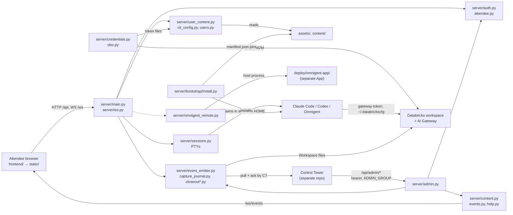

# Repository map: structure and boundaries

A curated map, not a file listing. Use it to find where something lives, what owns it, and
what else depends on it. Routing by task is in [README.md](README.md); execution paths are in
[FLOWS.md](FLOWS.md).

## Inspection record

- **Revision inspected:** `main` at `c1bae5d` ("CI: shorten test and release feedback loops"),
  2026-11-07. The tree was clean before this guide was added.
- **Method:**
  - Read the manifests, `Makefile`, CI workflows, `app.yaml` and `server/main.py` (routes and
    lifespan) in full.
  - Traced the flows in FLOWS.md by reading code excerpts along each call chain, with targeted
    greps for callers.
  - Read the module docstrings of `server/`, `server/bootstrap/`, `evals/` and `scripts/`.
  - About 40k lines of Python live in `server/`, and not every line was read.
- **Executed:** the full pytest suite (both passes), frontend tests and build, and the
  instruction-loading probes. Results are in [CHANGE_GUIDE](CHANGE_GUIDE.md#commands).
- **Markers below:**
  - *(traced)*: followed through code.
  - *(inventoried)*: responsibility taken from docstrings, names or manifests only.
  - *(unverified)*: claimed by a doc, not checked.

## Top-level map

| Path | Responsibility | Status | Notes |
| --- | --- | --- | --- |
| `server/` | FastAPI backend, the whole runtime | active *(traced: spine, identity, sessions, credentials, attendee env, CT surfaces, bootstrap)* | runtime root, packaged |
| `server/bootstrap/` | boot-time toolchain installers and the manifest contract | active *(traced)* | see [toolchain guide](areas/toolchain-and-release.md) |
| `frontend/` | React 19 + Vite + xterm.js source | active *(traced: terminal, events, api)* | has [frontend/AGENTS.md](../../frontend/AGENTS.md) |
| `static/` | committed production build of `frontend/` | **generated**; never hand-edit | runtime root; CI diff-checks it |
| `assets/instructions/` | templates for the attendee agents' CLAUDE.md / AGENTS.md | active product payload *(traced)* | read by `server/user_content.py` |
| `assets/skills/` | skills offered to attendee agents | mostly **vendored** upstream; fork-only skills are authored | see `assets/skills/SKILLS_SOURCE.md` |
| `assets/bin/` | helper CLIs installed into attendee `~/.local/bin` | active *(traced: deploy, export, init-project)* | Python/bash scripts with tests |
| `assets/artifacts/` | reviewed toolchain manifest, locks, installer scripts | **generated** manifest plus pinned locks | `manifest.json` has a GENERATED header |
| `assets/design-references/`, `assets/brand/` | design reference compositions; brand fonts and logos | active *(inventoried)* | `scripts/check_design_references.py` |
| `content/` | default nugget pack, agent catalogue, demo seed manifest | active *(traced)* | runtime root |
| `scripts/` | dev deploy, release build, refresh, fleet, soak, eval entry points | mixed: see [scripts](#scripts) | not packaged |
| `tests/` | pytest suite (~180 files) and JSON schemas in `tests/fixtures/` | active | `make test` runs only `tests/` |
| `evals/generated_apps/` | generated-app evaluation harness | active, opt-in *(inventoried)* | never imported by `server/` |
| `deploy/omnigent-app/` | separate Databricks App wrapping the `omnigent` wheel | active *(inventoried)* | own `pyproject.toml` and `uv.lock` |
| `docs/` | contracts, runbooks, milestone records, ADRs | mixed: see [docs](#docs) | CT's operator assistant ingests `docs/**/*.md`, except `docs/agent-guide/` |
| `.github/workflows/` | CI (`ci.yml`), tag release (`release.yml`), weekly skills drift | active *(traced)* | contract-tested by `tests/test_ci_contract.py` |
| `app.yaml` | Apps entry point, env defaults, OTel config | active | `WORKSHOP_PAT` must stay empty |
| `pyproject.toml`, `uv.lock`, `requirements*` | Python dependency contract | `pyproject.toml` is canonical | see [sources of truth](#sources-of-truth) |
| `dependency_sources.py` | public-registry guard for every dependency input | active | first CI job |

## Server modules by responsibility

One line each. Symbols are the usual entry points.

| Group | Modules | Entry points |
| --- | --- | --- |
| Spine | `server/main.py` (attendee routes, lifespan, SPA), `server/admin.py` (operator router), `server/ws.py` (terminal and event sockets), `server/evaluation.py` (synthetic CT evaluation router, default off), `server/network_check.py` (browser network probe router) | `server/main.py::lifespan`, `server/admin.py::router`, `server/ws.py::router` |
| Identity and access | `server/auth.py`, `server/attendee.py` (single-owner binding), `server/topology.py` (one attendee, one session) | `server/auth.py::get_current_user`, `server/auth.py::require_admin` |
| Sessions | `server/sessions.py` (live PTYs), `server/session_store.py` (metadata journal), `server/agents.py` (catalogue and allowlist), `server/supervisor.py` (parent process) | `server/sessions.py::session_manager`, `server/agents.py::load_catalog` |
| Per-attendee runtime | `server/users.py` (HOME, env), `server/user_content.py` (instructions, skills, MCP), `server/cli_config.py` (CLI configs and tokens), `server/codex_home.py`, `server/projects.py`, `server/build_plan.py`, `server/build_restore.py`, `server/design_workflow.py`, `server/skill_routing.py`, `server/demo_data.py` | `server/user_content.py::provision`, `server/users.py::User.shell_env` |
| Attendee-owned state | `server/attendee_state.py`, `server/attendee_profile.py`, `server/attendee_names.py`, `server/attendee_roster.py`, `server/attendee_app_group.py` *(inventoried)* | `server/attendee_state.py` |
| Wizard and build journey | `server/wizard.py`, `server/wizard_llm.py`, `server/wizard_selections.py`, `server/journey.py`, `server/discovery.py` | `server/wizard.py::state`, `server/journey.py::view` |
| Credentials | `server/credentials.py` (app-SP OAuth), `server/obo.py` (attendee OBO), `server/selfheal.py` | `server/credentials.py::credential_manager` |
| Governance | `server/model_policy.py`, `server/models.py`, `server/spend.py`, `server/gateway_errors.py`, `server/entitlements.py` | `server/model_policy.py::store`, `server/entitlements.py::entitlement_manager` |
| CT steering and help | `server/content.py`, `server/events.py`, `server/help.py` | `server/content.py::content_service`, `server/events.py::event_hub` |
| Capture and closeout | `server/event_emitter.py`, `server/capture.py`, `server/capture_journal.py`, `server/capture_io.py`, `server/stats.py`, `server/insight_summary.py`, `server/friction_scanner.py`, `server/artifacts.py`, `server/closeout*.py`, `server/workshop_lifecycle.py`, `server/event_deadline.py`, `server/certificate.py` | `server/event_emitter.py::event_emitter`, `server/closeout.py::manager` |
| Observability and ops | `server/otel_bootstrap.py`, `server/observability.py`, `server/telemetry.py`, `server/operational.py`, `server/log_collector.py`, `server/diagnostics.py`, `server/runtime_timing.py`, `server/readiness.py`, `server/bounded_work.py`, `server/browser_evidence.py` | `server/readiness.py::evaluate_runtime`, `server/telemetry.py::emit` |
| Omnigent | `server/omnigent_remote.py` | `server/omnigent_remote.py::remote_host_manager` |
| Toolchain | `server/bootstrap/install.py` and its sub-installers | `server/bootstrap/install.py::run_in_background` |

`server/config.py` holds the environment accessors. Most read one variable; some group
several, as `server/config.py::branding` does. `server/otel_bootstrap.py` reads a few
directly. The canonical table of variables is [docs/admin-api.md: env vars](../admin-api.md#deploy-time-configuration-env-vars).

## Component diagram

Arrows were checked against imports and call sites in `server/main.py` and the modules named.
The "token files" edge is `server/credentials.py::CredentialManager._fanout` calling
`server/cli_config.py::update_tokens`.

## Sources of truth

| Concern | Canonical | Derived or generated | Kept in sync by |
| --- | --- | --- | --- |
| Python runtime deps | `pyproject.toml` (exact `==` pins) | `uv.lock`; `requirements.txt` and `requirements-dev.txt` (`uv export`); `requirements.in` and `requirements-dev.in` (hand mirrors) | CI `backend` job diff; `tests/test_release_artifact.py`; `tests/test_ci_contract.py` |
| Frontend | `frontend/src/` and `frontend/package-lock.json` | `static/` | CI `frontend` job (`git diff --exit-code -- static`) |
| Toolchain pins | version constants in `server/bootstrap/install.py`, `server/bootstrap/apx.py`, `server/bootstrap/impeccable.py`, `server/bootstrap/browser_runtime.py` | `assets/artifacts/manifest.json` (`scripts/build_artifact_manifest.py --write`) | weekly `skills-freshness.yml`; `tests/test_artifact_manifest.py` |
| Upstream skills | the `databricks-agent-skills` commit pinned by `server/bootstrap/install.py::SKILLS_REF` and the manifest | vendored `assets/skills/` (`scripts/refresh_vendored_skills.py --write`) | `tests/test_skills_provenance.py`; weekly drift job |
| Attendee agent instructions | `assets/instructions/*.md` plus the composition in `server/user_content.py` | `~/.claude/CLAUDE.md` and `~/.codex/AGENTS.md` in each attendee HOME | `tests/test_user_content.py`, `tests/test_workshop_contract.py` |
| Agent catalogue | `content/agents.json` filtered by `server/agents.py::SUPPORTED_AGENT_IDS` | `GET /api/agents` | `tests/test_agent_selection.py`, `tests/test_pi_retirement_contract.py` |
| Content pack schema | `server/content.py::ContentPack` (pydantic); default `content/default_pack.json` | packs pushed by CT or `scripts/push_content.py` | `tests/test_content.py` |
| Env var semantics | `server/config.py` accessors | defaults in `app.yaml`; table in `docs/admin-api.md` | `tests/test_app_runtime_config.py` |
| CT wire contracts | `docs/admin-api.md`, `docs/workshop-insight-contract.md`, `docs/wt02-sealed-workshop-closeout.md`, `docs/omnigent-control-tower-contract.md` | JSON schemas in `tests/fixtures/` (strict); example payloads in `docs/examples/` | contract tests (`tests/test_insight_contract.py`, `tests/test_closeout_contract.py`, `tests/test_omnigent_app_contract.py`) |
| Observability taxonomy | `docs/observability.md` and `server/telemetry.py` | OTel attribute allowlist `server/observability.py::safe_event_attributes` | `tests/test_event_taxonomy.py`, `tests/test_observability.py` |
| Release contents | `scripts/build_release.py::RUNTIME_ROOTS` | `workshop-terminal.pex`, `release-manifest.json` | CI `package` job (double build plus `cmp`) |

## Where new code belongs

- **Attendee HTTP route:** `server/main.py`, behind `Depends(get_current_user)`. Operator or CT
  route: `server/admin.py`, which applies `require_admin` to the whole router. WebSocket:
  `server/ws.py`.
- **Helper-callback routes** (called from attendee helper CLIs): `server/main.py` with
  `server/main.py::_callback_identity` (capability token), as `/api/obo/refresh` and
  `/api/entitlements/reconcile` do.
- **New environment variable:** add an accessor in `server/config.py`, a default in
  `app.yaml` if CT should see it, and a row in the `docs/admin-api.md` env table.
- **New per-attendee file or CLI setting:** `server/cli_config.py` for CLI config and tokens,
  or a step in `server/user_content.py::provision` for content. An env var that must reach
  PTYs goes in `server/users.py::_SHELL_ENV_ALLOWLIST`, which is deny-by-default.
- **New agent type:** add it to `content/agents.json` **and**
  `server/agents.py::SUPPORTED_AGENT_IDS`. The server allowlist wins.
- **New attendee helper command:** `assets/bin/`, plus the install list in
  `server/user_content.py::_install_cli_helpers`.
- **New pinned tool:** constants in `server/bootstrap/`, then regenerate the manifest
  ([toolchain guide](areas/toolchain-and-release.md)).
- **New CT-visible event:** `server/telemetry.py` vocabulary, then `docs/observability.md`.
  If CT consumes it, also `docs/workshop-insight-contract.md`, the schema in `tests/fixtures/`
  and an example in `docs/examples/`.
- **New harvested stat:** `server/stats.py::gather_user`, not `server/admin.py`. Bump
  `server/stats.py::STATS_SCHEMA_VERSION` only when removing or retyping a field (see
  [Versioning](../workshop-insight-contract.md#versioning) in the insight contract).
- **Frontend network call:** `frontend/src/api.ts`.

## Easily confused

| These | Differ how |
| --- | --- |
| `server/auth.py` vs `server/identity.py` vs `server/attendee.py` | auth authorizes requests; identity only *records* which principal each CLI resolved to (`identity.resolved`); attendee holds the instance's single owner binding |
| `server/attendee_*.py` | state (`attendee_state.py`), preferences (`attendee_profile.py`), self-declared name (`attendee_names.py`), CT roster facts (`attendee_roster.py`), account-group enrolment (`attendee_app_group.py`) |
| `server/artifacts.py` vs `server/bootstrap/artifacts.py` vs `assets/artifacts/` | attendee-activity harvest for closeout and summaries vs toolchain checksum contract vs the pinned files themselves |
| `server/otel_bootstrap.py` vs `deploy/omnigent-app/otel_bootstrap.py` | WT launcher (uvicorn, supervisor) vs the paired Omnigent App launcher |
| `server/events.py` vs `server/event_emitter.py` vs `server/telemetry.py` | in-process fan-out to browser tabs vs retained CT delivery journal vs the event vocabulary that feeds both CT and OTel |
| `server/observability.py` vs `server/operational.py` | OTel export only vs CT-only process health |
| `server/sessions.py` vs `server/session_store.py` | live PTY registry vs metadata-only restart journal ("ghosts") |
| `server/credentials.py` vs `server/obo.py` vs `server/selfheal.py` | app-SP bearer for builds (`[DEFAULT]`) vs the attendee's OBO token (`[me]`, off unless `ENABLE_OBO`) vs recovery orchestration that is not a credential source |
| `server/wizard.py` / `server/wizard_llm.py` / `server/wizard_selections.py` | brief and ideas / model suggestions with deterministic fallback / offer tokens |
| `server/journey.py` / `server/build_plan.py` / `server/design_workflow.py` | "Your build" view and export / plan approval gate / per-project workflow record |
| `server/build_restore.py` vs `server/projects.py::recover` | automatic restore after a container restart vs attendee-initiated recovery |
| `server/help.py` vs `server/wizard_llm.py` | relay to CT with no model call (CT writes assistant replies) vs a WT-side model call |
| `server/evaluation.py` vs `evals/generated_apps/` vs `scripts/evaluate_workshop_contract.py` | runtime admin router for synthetic CT evaluations vs external harness vs a small MLflow probe |
| `assets/instructions/CLAUDE.md` vs repo-root instructions | the **attendee** agent template, never instructions for agents working on this repo |
| `assets/skills/` vs `DATA_ROOT/shared/skills` | vendored fallback in the image vs the runtime-published tree, used when its install is ready |
| `requirements.in` vs `pyproject.toml` | hand mirror enforced by tests vs the canonical contract |

## Real versus mock execution paths

- **`LOCAL_DEV=1`** (`make dev-backend`, the test suite via `tests/conftest.py`):
  - uses a fake identity from `DEV_FAKE_EMAIL` and `DEV_GROUPS`;
  - skips app-identity initialization, capture configuration, installers, credential
    rotation, the entitlement reconciler and the CT reporter threads (`server/main.py::lifespan`).
- **Tests** set `DATA_ROOT` to a temp dir and disable the background build restore. They run
  PTYs for real; `host_process` tests also exercise real signals.
- **Capture storage** has in-memory and local seams for tests. Production uses
  `WorkspaceCaptureStorage` via `server/capture.py::configure`.
- **Simulated Control Tower:** `evals/generated_apps/adapters/simulated_control_tower.py` and
  `scripts/run_generated_app_journey.py` (default). `scripts/deploy_ct_sim.py` performs a
  *real* deploy that mimics CT.
- **Fake OTLP collector:** `scripts/fake_otlp_collector.py`, used only by the release smoke.
- **Rendered browser tests** skip unless `WORKSHOP_E2E_BROWSER_TESTS=1` and Playwright are
  available.

## Scripts

| Kind | Scripts | Needs |
| --- | --- | --- |
| Offline checks | `scripts/check_dependency_sources.py`, `scripts/check_quality_toolchain.py`, `scripts/check_design_references.py`, `scripts/measure_startup_context.py` | uv; some need network |
| Toolchain refresh | `scripts/build_artifact_manifest.py`, `scripts/refresh_vendored_skills.py`, `scripts/refresh_apx.py`, `scripts/refresh_impeccable.py`, `scripts/validate_codex_packages.py` | network to upstreams |
| Linux toolchain qualification | `scripts/check_apx_toolchain.py`, `scripts/check_agentbricks_toolchain.py` | Linux (CI) |
| Release | `scripts/build_release.py`, `scripts/smoke_release.py`, `scripts/smoke_release_container.sh`, `scripts/smoke_browser_container.sh`, `scripts/smoke_otel_entrypoint.py`, `scripts/benchmark_release.py` | Linux x86_64 CPython 3.11; a container runtime for the `.sh` smokes |
| Deploy to a workspace | `scripts/deploy_dev.py`, `scripts/deploy_ct_sim.py`, `scripts/deploy_ct_compatible_wt_test.py`, `scripts/deploy_generated_app_test.py`, `scripts/probe_omnigent_app_build.py` | **live workspace** |
| Fleet and live instances | `scripts/push_content.py`, `scripts/pull_diagnostics.py`, `scripts/soak.py`, `scripts/rehearse.py`, `scripts/ct_*.py`, `scripts/smoke_models.py`, `scripts/regress_mode2.py` | **live app URL and an admin token**; `scripts/soak.py chaos` mutates |
| Generated-app evaluation | `scripts/evaluate_generated_apps.py`, `scripts/run_generated_app_journey.py`, `scripts/seed_generated_app_fixture.py`, `scripts/verify_generated_app_result.py`, `scripts/authenticate_generated_app_attendee.py`, `scripts/fetch_wt_test_release.py`, `scripts/qualify_ct_compatible_wt_test.py` | mostly live; see the runbook |

## Docs

These classifications come from titles, headings and the cross-checks in this guide. A
milestone record may describe superseded behaviour; verify it against code before relying on it.

- **Contracts (keep exact):**
  - CT and runtime: `docs/admin-api.md`, `docs/workshop-insight-contract.md`,
    `docs/wt01-durable-capture-delivery.md`, `docs/wt02-sealed-workshop-closeout.md`,
    `docs/observability.md`, `docs/control-tower-implementation.md` (instructions for the CT side).
  - Identity, models and Omnigent: `docs/auth-identity-model.md`, `docs/governed-ai-gateway.md`,
    `docs/omnigent-control-tower-contract.md`, `docs/omnigent-modes.md`.
  - Toolchain and release: `docs/artifact-manifest.md`, `docs/release-artifact.md`.
  - Attendee features: `docs/app-deploy-tool.md`, `docs/take-home-export.md`,
    `docs/attendee-messaging.md`, `docs/agent-bricks-cli.md`.
  - Pinned by tests: `tests/test_auth_identity_doc.py` and `tests/test_operator_runbook.py`
    assert claims in these docs.
- **Runbooks and gates:** `docs/operator-runbook.md`, `docs/verification-gate.md`,
  `docs/two-instance-test-runbook.md`, `docs/generated-app-evaluation-runbook.md`,
  `docs/wt01-qualification-runbook.md`, `docs/omnigent-acceptance-checklist.md`,
  `docs/final-release-qualification.md`, `docs/control-tower-test-parity.md`.
- **Example payloads:** `docs/examples/*.json`, validated against the schemas by the contract
  tests (for example `tests/test_insight_contract.py`).
- **Decisions:** `docs/adr/0001-workshop-insight-capture.md`,
  `docs/adr/0002-attendee-credential.md`, `docs/adr/0003-shared-demo-catalog.md`.
- **Milestone and design records (historical, verify first):**
  - Milestone write-ups: `docs/wizard-journey-r03.md`, `docs/preparation-r04.md`,
    `docs/context-aware-ux-r05.md`, `docs/ux-stack-comparison-r07.md`,
    `docs/project-continuity-r08.md`, `docs/workshop-interaction-contract-r02.md`,
    `docs/ct08-runtime-throughput.md`, `docs/wt03-closeout-contract-qualification.md`.
  - Dated toolchain record: `docs/toolchain-release-refresh.md` (11 October pins; current
    pins are in code and the manifest).
  - Audits and validation: `docs/onboarding-wizard-audit.md`,
    `docs/app-quality-audit-and-remediation-plan.md`, `docs/remediation-validation.md`,
    `docs/event-audit-ai-dev-day-2026-11-04.md`.
  - Design and planning: `docs/model-comparison.md`, `docs/OMNIGENT_INTEGRATION.md` (a design
    marked implemented in June 2026), `docs/ROADMAP.md`. Phase 0 of the roadmap still lists
    early items such as "Merge Control Tower PR #5", so treat it as stale *(unverified)*.

## Known doc and code discrepancies

Each was verified in code during this inspection. They are recorded, not fixed: each needs
an owner's decision about which side is intended.

- **Broadcast surface.** `docs/admin-api.md` says `POST /api/admin/broadcast` "shows a
  banner". `server/content.py::Broadcast.surface` defaults to `"toast"`; only an explicit
  `"banner"` is retained (`tests/test_content.py`).
- **Broadcast `clear_help`.** `docs/admin-api.md` documents `clear_help`. In `server/`, the
  only mention is a historical docstring in `server/admin.py`.
- **Insight delivery.** `docs/workshop-insight-contract.md` says "the Terminal does not push".
  `server/event_emitter.py::flush_loop` still pushes when the CT ingest env vars are set.
  `docs/control-tower-implementation.md` describes that path as optional.
- **Omnigent default.** A comment in `server/agents.py::load_catalog` says Omnigent is
  "feature-flagged off by default". `server/config.py::omnigent_enabled` defaults to on.
- **Module docstring.** `server/main.py` calls itself a "multi-user coding-agent workbench".
  The supported topology is one attendee per instance (`server/topology.py`).
- **Unused trigger set.** `server/content.py::KNOWN_TRIGGERS` is defined but never read.
  Trigger strings are not validated against it.
- **Diagnostics sections.** The `GET /api/admin/diagnostics` table in `docs/admin-api.md`
  omits the `capture_delivery` and `runtime_timings` sections that `server/admin.py`
  returns *(reported by the trace, not re-read)*.

## Inventoried only or unverified

- **Not traced:**
  - `server/browser_evidence.py`, `server/friction_scanner.py`, `server/bounded_work.py`,
    `server/runtime_timing.py`, `server/network_check.py`, `server/evaluation.py` and
    `server/certificate.py` internals.
  - The `server/attendee_*.py` modules beyond their docstrings.
  - `deploy/omnigent-app/` internals beyond its entry points.
  - Most of `evals/generated_apps/`.
  - `assets/design-references/`.
- **Outside this repository:** how Control Tower chooses between its git-clone and packaged
  (PEX) deploy paths was read only enough to confirm both exist. They are in
  `src/control_tower/backend/databricks/real.py` of the CT repo.
